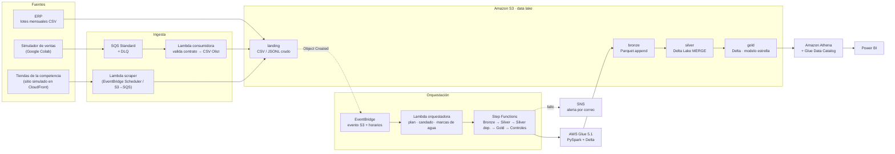
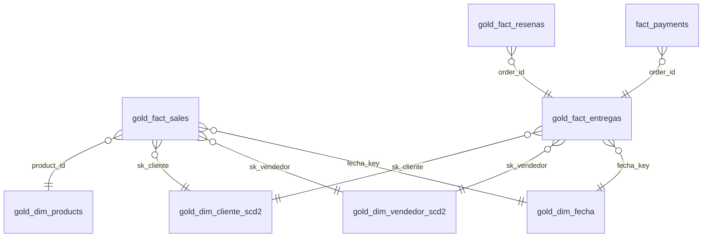
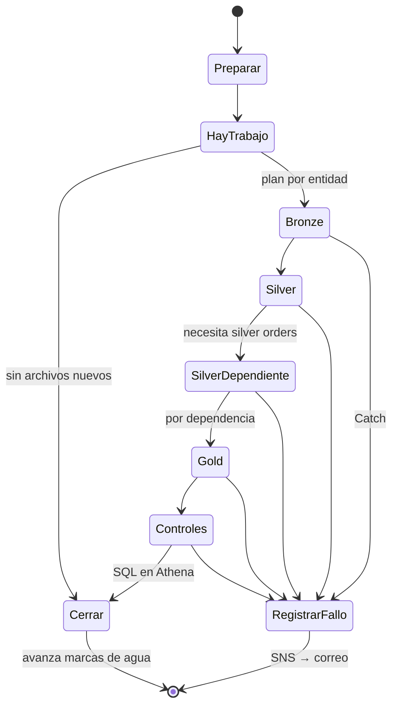

# Olist Lakehouse en AWS · Arquitectura medallion con ingesta por eventos

[](https://github.com/favc0608/Project_Olist_Data_Engineer/actions/workflows/ci.yml)


[](LICENSE)

> Proyecto final del Diplomado de Ingeniería de Datos (DMC) · Grupo 1
> Lakehouse de punta a punta sobre AWS para un e-commerce real (dataset público de Olist, Brasil):
> ingesta por lotes y en streaming, capas **landing → bronze → silver → gold**, **SCD Tipo 1 y Tipo 2**,
> orquestación incremental con **Step Functions**, controles de calidad automáticos y consumo en **Power BI** vía **Athena**.

**English summary.** End-to-end data lakehouse on AWS for a Brazilian marketplace (Olist public dataset).
Monthly ERP batches and a synthetic real-time sales stream (Colab → SQS → Lambda) land as CSV in S3; AWS Glue
(PySpark + Delta Lake) builds bronze/silver/gold layers with SCD Type 1 and Type 2; a Lambda + Step Functions
orchestrator runs only what changed (per-entity watermarks, S3-based lock, retries, failure brake, pause), runs
SQL data-quality checks in Athena and alerts by e-mail through SNS. A third source scrapes simulated competitor
web stores (CloudFront) to build a price history. Gold is a star schema consumed from Power BI through Athena.
Everything is infrastructure as code (CloudFormation) and the orchestration logic is unit-tested.

---

## Contenido

1. [Problema de negocio](#1-problema-de-negocio)
2. [Arquitectura](#2-arquitectura)
3. [Stack tecnológico](#3-stack-tecnológico)
4. [Fuentes e ingesta](#4-fuentes-e-ingesta)
5. [Almacenamiento y capas](#5-almacenamiento-y-capas)
6. [Procesamiento y SCD](#6-procesamiento-y-scd)
7. [Modelo gold](#7-modelo-gold)
8. [Orquestación](#8-orquestación)
9. [Calidad, seguridad y monitoreo](#9-calidad-seguridad-y-monitoreo)
10. [Resultados](#10-resultados)
11. [Cómo reproducirlo](#11-cómo-reproducirlo)
12. [Estructura del repositorio](#12-estructura-del-repositorio)
13. [Decisiones y lecciones](#13-decisiones-y-lecciones)
14. [Equipo y créditos](#14-equipo-y-créditos)

Documentación detallada en [`docs/`](docs/).

---

## 1. Problema de negocio

Olist conecta a pequeños y medianos comercios con los grandes marketplaces de Brasil. La información de ventas,
logística, pagos y reseñas está dispersa en varios sistemas, los reportes se generan tarde y no hay trazabilidad
entre el cliente final y la logística.

**Preguntas de negocio que responde la capa gold**

| # | Pregunta | Tablas gold |
|---|---|---|
| 01 | ¿Cuáles son las categorías y productos más vendidos? | `gold_fact_sales`, `gold_dim_products` |
| 02 | ¿Cómo optimizar los tiempos de entrega y la logística? | `gold_fact_entregas`, `gold_fact_resenas` |
| 03 | ¿Qué vendedores tienen el mejor rendimiento histórico? | `gold_fact_sales`, `gold_fact_entregas`, `gold_dim_vendedor_scd2` |

Además, una fuente externa (precios de la competencia) permite comparar el precio propio con el del mercado.

## 2. Arquitectura



Diagrama completo (7 páginas: visión general, streaming, medallion ERP, orquestación, web, modelo SCD e
infraestructura) en [`docs/diagramas/arquitectura_olist.drawio`](docs/diagramas/arquitectura_olist.drawio)
(abrir con [diagrams.net](https://app.diagrams.net/)).

## 3. Stack tecnológico

| Capa | Servicios / herramientas |
|---|---|
| Ingesta | Amazon SQS (Standard + DLQ), AWS Lambda (Python 3.12), Amazon EventBridge (reglas y Scheduler), Google Colab |
| Almacenamiento | Amazon S3 (un bucket, prefijos por sistema y capa), Parquet, **Delta Lake** |
| Procesamiento | **AWS Glue 5.1** (Spark 3.5, PySpark), job bookmarks, Delta `MERGE` |
| Catálogo y consulta | AWS Glue Data Catalog, **Amazon Athena** (tablas Delta nativas, partition projection) |
| Orquestación | **AWS Step Functions** (Map + `glue:startJobRun.sync`), Lambda orquestadora, EventBridge |
| Calidad y monitoreo | Controles SQL en Athena, Amazon CloudWatch Logs, **Amazon SNS** |
| Infraestructura | **AWS CloudFormation** (3 stacks), IAM con roles por servicio |
| Consumo | Power BI (conector ODBC de Athena) |
| Fuente web | Sitio estático generado con Python (stdlib), S3 privado + CloudFront (OAC), scrapers stdlib |
| Calidad de código | `unittest` con dobles de AWS (orquestador, Lambdas, contrato de mensajes) |

## 4. Fuentes e ingesta

El proyecto combina **datos transaccionales en tiempo real** y **datos incrementales por lotes**, que es el caso
típico de una empresa real:

| Fuente | Tipo | Cómo llega | Entidades |
|---|---|---|---|
| ERP (dataset de Olist, 2016-2018) | Lotes mensuales | CSV en `erp/landing/<entidad>/year=AAAA/month=MM/` | orders, order_items, payments, customers, products, sellers, reviews, geolocation, category_translation |
| Simulador de ventas (Colab) | Streaming | Eventos JSON → SQS → Lambda → **el mismo CSV del ERP** | pedidos y sus cambios de estado, pagos, clientes, reseñas |
| Competencia (4 tiendas simuladas) | Scraping diario o por cambio | Lambda scraper → JSONL en `web/landing/precios/` | precio, descuento y stock por producto y tienda |

- El simulador es un paquete propio y público: [DMC_G1_SAAS](https://github.com/favc0608/DMC_G1_SAAS). Genera
  ventas con las distribuciones reales de Olist (horarios, montos, rutas, tiempos de entrega, puntajes) y un
  **contrato de mensaje versionado** (`evento_id`, `tipo`, `ts_evento`, `version`, `payload`).
- La Lambda consumidora valida cada evento: los inválidos van a `erp/landing/rechazados/` con su motivo y **no
  frenan el lote**. La DLQ solo recibe fallos de infraestructura.
- SQS Standard (no FIFO) a propósito: FIFO limita lotes a 10 mensajes y produciría miles de archivos diminutos.
  La consecuencia (entrega al menos una vez, sin orden) se resuelve aguas abajo con deduplicación y `MERGE`.
- Los lotes históricos se generan de forma reproducible con [`scripts/generar_lotes_historicos.py`](scripts/generar_lotes_historicos.py).

Detalle: [`docs/02_ingesta.md`](docs/02_ingesta.md).

## 5. Almacenamiento y capas

```
s3://<bucket-lakehouse>/
├── erp/
│   ├── landing/<entidad>/year=AAAA/month=MM/*.csv     crudo, tal cual llega
│   │   ├── eventos/      copia cruda de cada lote del streaming (JSONL.gz)
│   │   └── rechazados/   eventos inválidos con _motivo
│   ├── bronze/<entidad>/year=/month=/                 Parquet append + trazabilidad
│   ├── silver/<entidad>/                              Delta Lake (limpio, tipado, sin duplicados)
│   ├── gold/<tabla>/                                  Delta Lake (modelo estrella)
│   └── _control/orquestacion/                         candado, pendiente, marcas de agua, controles, fallos
└── web/
    ├── landing/precios/ · bronze/ · silver/           precios de la competencia (SCD2)
```

| Capa | Formato | Regla |
|---|---|---|
| Landing | CSV / JSONL | Inmutable: conserva el archivo original para reprocesar |
| Bronze | Parquet, partición `year/month` del periodo de negocio | Append con **job bookmark**; agrega `_source_file` e `_ingested_at`; valida encabezados y claves |
| Silver | Delta Lake | Deduplica por clave quedándose con lo más reciente, tipa, estandariza (zips de 5 dígitos), `row_hash`, `MERGE` |
| Gold | Delta Lake (+ 2 tablas Parquet de Power BI) | Hechos y dimensiones listos para negocio; joins a la versión SCD2 vigente |

Detalle: [`docs/03_almacenamiento_y_modelo.md`](docs/03_almacenamiento_y_modelo.md).

## 6. Procesamiento y SCD

28 jobs de Glue (`glue/`), uno por entidad y capa, con validaciones antes de escribir (encabezados, nulos en
claves, duplicados, conteos) que lanzan `ValueError` si algo no cuadra.

| Estrategia | Dónde | Cómo |
|---|---|---|
| **SCD Tipo 1** (sobrescribe) | orders, order_items, customers, products, category_translation, reviews | Delta `MERGE` por clave que solo actualiza si cambió el `row_hash` (sha2 de las columnas de negocio). En pedidos, desempate por avance del estado (`created` < `approved` < … < `delivered`) |
| **SCD Tipo 2** (historiza) | clientes (`silver_customers_scd2`), vendedores (`silver_sellers`), precios web | `valid_from`, `valid_to`, `is_current`, `version`, `row_hash` y clave sustituta `sk = sha2(id ‖ valid_from)`. La historia se **recalcula completa** y se aplica con `MERGE` (inserta, cierra y borra versiones invalidadas): idempotente |

- Clientes: Olist crea un `customer_id` por pedido; la persona real es `customer_unique_id`. El SCD2 historiza
  zip, ciudad y estado por persona y fecha la versión con la **fecha de compra**.
- Vendedores: la versión empieza en el periodo del lote del ERP en que llegó el cambio.
- Los hechos se unen a la versión vigente a la fecha de compra (`valid_from <= compra < valid_to`).

Detalle y ejemplos: [`docs/04_procesamiento_y_scd.md`](docs/04_procesamiento_y_scd.md).

## 7. Modelo gold



| Tabla | Grano | Uso |
|---|---|---|
| `gold_fact_sales` | ítem de pedido | ventas, categorías (en inglés), vendedor y cliente vigentes a la compra |
| `gold_fact_entregas` | pedido | días por etapa, `dias_atraso`, `llego_tarde`, ruta vendedor → cliente, flete |
| `gold_fact_resenas` | reseña | puntaje vs. atraso de la entrega |
| `fact_payments` | pago | medios de pago y cuotas |
| `gold_dim_fecha` | día (2016-2026) | calendario con fines de semana, Black Friday y fecha de presentación |
| `gold_dim_cliente_scd2` / `gold_dim_vendedor_scd2` | versión | dimensiones históricas con región |
| `gold_dim_products`, `gold_dim_customers`, `gold_geolocation` | entidad | dimensiones usadas por el tablero |
| `gold_v_competencia_*` (3 vistas) | producto / día / tienda | precio actual, serie diaria y resumen por tienda |

## 8. Orquestación



- **Disparadores:** evento de S3 por archivo nuevo, horario de respaldo cada 3 h y revisión de pendientes cada 10 min.
  También se puede iniciar a mano desde la consola de Step Functions.
- **Plan incremental:** la Lambda guarda una **marca de agua por entidad** y solo ejecuta los jobs de las
  entidades con archivos nuevos y los gold que dependen de ellas.
- **Robustez:** candado en S3 con escritura condicional (`If-None-Match`), intervalo mínimo entre corridas,
  **freno tras 2 fallos seguidos**, pausa manual para mantenimiento, detección de jobs ya en ejecución,
  reintentos con backoff ante `ConcurrentRunsExceeded` y registro de cada ejecución y fallo en S3.

Detalle: [`docs/05_orquestacion.md`](docs/05_orquestacion.md).

## 9. Calidad, seguridad y monitoreo

- **Controles de calidad automáticos** (estado `Controles`): 10 consultas en Athena al final de cada corrida
  (duplicados por clave, una sola versión vigente en SCD2, vigencias que encadenan, huérfanos entre hechos y
  dimensiones, entregados sin fecha). Si alguna devuelve filas, la ejecución falla y se alerta.
- **Alertas:** regla de EventBridge ante ejecución fallida → SNS → correo con el nombre de la ejecución.
- **Monitoreo:** CloudWatch Logs de Lambdas y jobs; historial propio en `_control/orquestacion/`.
- **Seguridad:** bucket privado; sitio de la competencia solo accesible por CloudFront (OAC);
  roles IAM por servicio; el usuario del simulador solo puede `sqs:SendMessage`; sin credenciales en el código.

Detalle: [`docs/06_calidad_seguridad_monitoreo.md`](docs/06_calidad_seguridad_monitoreo.md).

## 10. Resultados

Histórico 2016-09 a 2017-12 (45 mil pedidos, 51 mil ítems, 45 mil reseñas) más ventas del simulador:

| | |
|---|---|
| Carga de un año completo (70 lotes mensuales) | **15 min** de punta a punta, 18 jobs, controles de calidad 11/11 en 0 |
| Costo por corrida completa | ~USD 0.30-0.50 |
| Entregas tardías | **5.6%** (3.9% mismo estado vs. 6.5% interestatal; SP → RJ 12.4%) |
| Reseña promedio | **4.28** a tiempo vs. **2.32** con atraso |
| Historia SCD2 | 89 clientes con cambio de dirección versionados |

Detalle, top de categorías y metodología en [`docs/10_resultados.md`](docs/10_resultados.md).

## 11. Cómo reproducirlo

Requisitos: cuenta de AWS, Python 3.12, AWS CLI y el dataset de Olist de Kaggle.

```bash
git clone https://github.com/favc0608/Project_Olist_Data_Engineer.git && cd Project_Olist_Data_Engineer
python -m venv .venv && source .venv/bin/activate             # Windows: .venv\Scripts\activate
make install                                                  # o: pip install -r requirements.txt -r requirements-dev.txt
make test                                                     # pruebas unitarias, sin AWS
python scripts/descargar_dataset.py                           # dataset de Kaggle en data/raw/olist/
make lotes                                                    # lotes mensuales de 2017 en build/lotes/
```

Despliegue paso a paso (stacks, jobs, tablas de Athena y primer pipeline): [`docs/09_despliegue.md`](docs/09_despliegue.md).

> Los identificadores de la cuenta original (número de cuenta, usuarios, distribución de CloudFront) se reemplazaron
> por marcadores `<...>`. El bucket y los prefijos se parametrizan en las plantillas y en cada job.

## 12. Estructura del repositorio

```
├── glue/                    jobs de AWS Glue (PySpark)
│   ├── bronze/ silver/ gold/ web/
│   └── compartido/          script común de payments/geolocation
├── lambda/
│   ├── consumidor/          SQS → valida contrato → CSV con columnas de Olist
│   ├── orquestador/         plan, candado, marcas de agua, controles en Athena
│   ├── web_scraper/         extrae precios de las 4 tiendas
│   └── web_publicador/      publica cambios de precio en el sitio
├── infra/
│   ├── cloudformation/      streaming · orquestación · web (IaC)
│   ├── athena/              DDL de tablas Delta nativas, vistas y controles
│   └── scripts/             empaquetado de Lambdas y subida con URLs prefirmadas
├── competencia/             generador del sitio de 4 tiendas, scrapers y validaciones
├── scripts/                 descarga y perfilado del dataset, generación de lotes
├── tests/                   pruebas unitarias con dobles de AWS
├── docs/                    arquitectura, decisiones, lecciones, resultados, despliegue
├── .github/workflows/       CI: lint + pruebas en cada push
└── Makefile                 install · test · lint · lotes · jobs
```

## 13. Decisiones y lecciones

Las decisiones de diseño (con alternativas descartadas y por qué) están en
[`docs/07_decisiones.md`](docs/07_decisiones.md) y lo que aprendimos en producción, en
[`docs/08_lecciones_aprendidas.md`](docs/08_lecciones_aprendidas.md). Algunas:

- Delta Lake en silver y gold para `MERGE` idempotente; Parquet append en bronze para conservar todo.
- Una Lambda + Step Functions en vez de Glue Workflows: plan incremental por entidad, reintentos finos y estado auditable.
- Glue **FLEX** es más barato pero sin garantía de capacidad: en pruebas los jobs esperaron hasta 30 min sin
  executors. El pipeline fuerza **STANDARD** por corrida.
- Sin crawlers en cada ciclo (cobran mínimo 10 min): tablas Delta nativas en Athena y partition projection.

## 14. Equipo y créditos

| Integrante | Rol en el proyecto |
|---|---|
| Alvaro | Negocio y propuesta de valor |
| Frank | Fuentes e ingesta, orquestación, seguridad y monitoreo |
| Bryan | Almacenamiento, procesamiento y catálogo de datos |
| William | Analítica, modelo de datos y visualización en Power BI |

- Dataset: [Brazilian E-Commerce Public Dataset by Olist](https://www.kaggle.com/datasets/olistbr/brazilian-ecommerce)
  (licencia CC BY-NC-SA 4.0). Los datos **no** se incluyen en este repositorio.
- Las tiendas de la competencia son ficticias; cualquier parecido con marcas reales es intencionalmente evitado.
- Código bajo licencia MIT (ver [`LICENSE`](LICENSE)).
