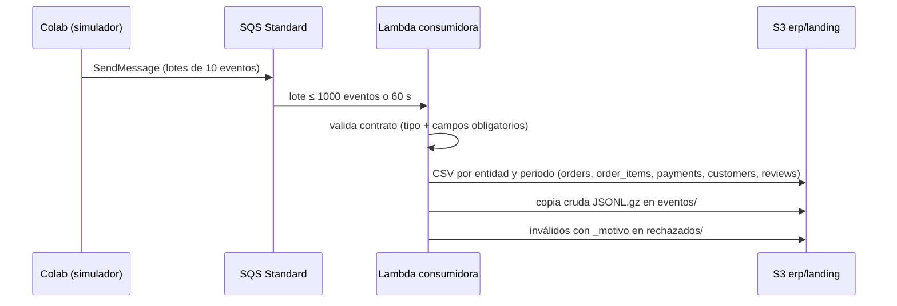

# 2. Fuentes e ingesta

El lakehouse recibe tres tipos de datos. Los dos primeros terminan en **el mismo formato** (CSV con las columnas
exactas de Olist), así que los jobs de bronze no distinguen si un pedido llegó en un lote mensual o en streaming.

## 2.1 ERP: lotes mensuales (datos incrementales)

- Ruta: `erp/landing/<entidad>/year=AAAA/month=MM/<entidad>_AAAA_MM.csv`.
- `year/month` es el **periodo de negocio**: mes de compra para pedidos, ítems y clientes; mes de creación para
  reseñas; mes de primera aparición en una venta para productos y vendedores.
- Se generan con [`scripts/generar_lotes_historicos.py`](../scripts/generar_lotes_historicos.py) a partir del
  dataset de Kaggle (reproducible y determinista).
- Payments y geolocation se cargaron como un CSV completo (carga inicial), algo habitual cuando un sistema no
  permite extraer por periodo.

## 2.2 Simulador de ventas: streaming (datos transaccionales)



**Simulador** ([repo propio](https://github.com/favc0608/DMC_G1_SAAS)): genera ventas sintéticas con un perfil
estadístico construido desde Olist (ventas por día y hora, montos, cuotas, rutas logísticas, tiempos de
aprobación/envío/entrega, tasa de cancelación, puntajes según atraso, recompra y cambio de dirección).
Cada venta recorre su ciclo de vida y emite eventos: `pedido_creado`, `pedido_aprobado`, `pedido_enviado`,
`pedido_entregado`, `pedido_cancelado`, `resena_creada`, `cliente_actualizado`.

**Contrato de mensaje (v2)**

```json
{"evento_id": "uuid5 determinista", "tipo": "pedido_entregado", "ts_evento": "2026-09-05T14:03:11Z",
 "version": "2", "payload": {"order_id": "...", "fecha": "...", "pedido": {"...fila completa de orders..."}}}
```

- `evento_id` determinista (uuid5): reenviar el mismo periodo no duplica datos tras deduplicar.
- Desde la v2, cada cambio de estado trae la **fila completa del pedido**, para que el ERP la guarde como
  una fila CSV válida por sí sola.
- La reseña se emite días después de la entrega: con periodos simulados muy cortos no aparecen reseñas.

**Lambda consumidora** ([`lambda/consumidor/`](../lambda/consumidor/)):
- `handler.py`: valida cada evento contra `PAYLOAD_OBLIGATORIO`; los inválidos van a `rechazados/` y no frenan el lote.
- `erp_csv.py`: convierte eventos en filas Olist (un pedido una sola vez por lote, en su estado más avanzado;
  un cliente por pedido; textos sin saltos de línea; zips de 5 dígitos).
- Concurrencia máxima 2 y lotes de hasta 1,000 mensajes o 60 s: archivos de tamaño razonable.
- **SQS Standard** (no FIFO): entrega al menos una vez y sin orden. Se compensa aguas abajo (bronze deduplica,
  silver se queda con el estado más reciente con `MERGE`). La **DLQ** recibe solo lotes que fallaron por
  infraestructura (tras 3 intentos).

## 2.3 Competencia: scraping de 4 tiendas simuladas

- 4 tiendas ficticias generadas con plantillas HTML/CSS y Python stdlib ([`competencia/`](../competencia/)),
  48 productos reales de Olist con precios en BRL, ~60 páginas por tienda.
- Hosting: bucket S3 privado + CloudFront con OAC (S3 directo devuelve 403), `X-Robots-Tag: noindex`.
  Sitio publicado: https://d1wz0ixjw02i7c.cloudfront.net/ (portal con enlaces a las 4 tiendas).
- `web_publicador`: aplica cambios de precio (por horario o desde un Colab de cambios) y guarda la "verdad"
  de cada versión para poder validar el scraping.
- `web_scraper`: extrae precio, precio anterior, descuento y stock de cada tienda con reglas específicas
  (`competencia/scrapers/`), valida reglas de negocio por tienda y escribe JSONL en `web/landing/precios/`.
  Dos disparadores: horario diario y, para la demo, evento de S3 (página modificada) → SQS → Lambda.

## 2.4 Garantías de la ingesta

| Riesgo | Mitigación |
|---|---|
| Mensaje duplicado (SQS Standard) | `evento_id` determinista + deduplicación en bronze/silver + `MERGE` |
| Mensajes fuera de orden | Silver conserva el estado más avanzado del pedido |
| Evento inválido | Se aparta en `rechazados/` con su motivo; el lote sigue |
| Falla de S3 o Lambda | Reintento de SQS (3) y luego DLQ con alarma |
| Archivo con columnas incorrectas | Bronze valida encabezados y falla de forma controlada (alerta por SNS) |
| El mismo archivo subido dos veces | Bookmark de Glue + `MERGE` por clave: sin duplicados en silver/gold |
